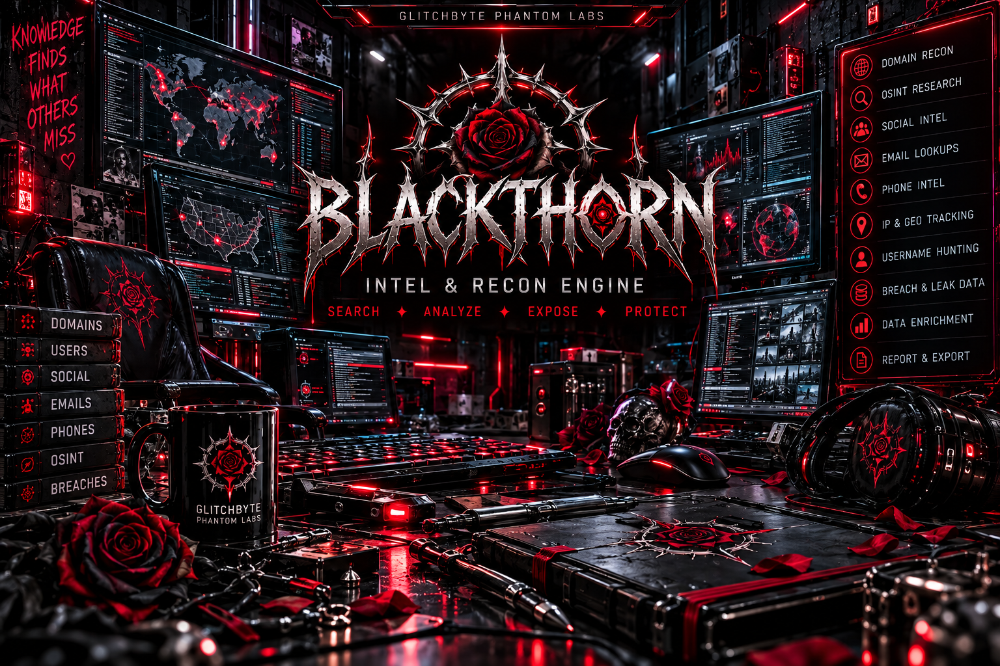
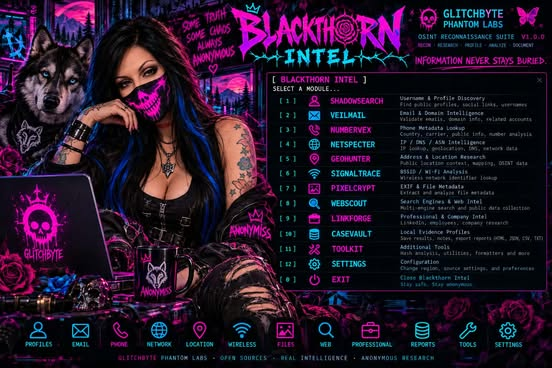

# BLACKTHORN INTEL v0.8.1 // DUAL APPROVED ART EDITION



Two approved, separate artworks, with no changes to the intelligence engine:

1. **Tool startup and `--cover`:** `art/BLACKTHORN-TOOL-COMMAND-DECK.png`, the professional tool-suite illustration. It opens at native resolution in an external picture viewer, not as pixelated terminal characters. The numbered terminal menu still works independently.
2. **Results image board / `--board-art`:** `art/BLACKTHORN-APPROVED-ROSIE-TATTOO.png`, the exact original Rosie + wolf + tattoo image, embedded in HTML at natural aspect ratio and full available width. Results appear after the artwork.

Neither file is altered, compressed, cropped, or replaced. Artwork is decorative: illustrated panel text is not a description of implemented modules. Trust the live terminal `--examples` and CLI `--help` for the real commands.

## Approved results artwork



## Install a separate version on Debian-based Linux

Download `BLACKTHORN-INTEL-v0.8.1-DUAL-ART.zip` into Downloads:

```bash
cd "$HOME/Downloads" &&
if [ -e "$HOME/BLACKTHORN-INTEL-v0.8.1" ]; then
  echo '[STOP] Existing installation preserved'
else
  unzip -q BLACKTHORN-INTEL-v0.8.1-DUAL-ART.zip -d "$HOME" &&
  cd "$HOME/BLACKTHORN-INTEL-v0.8.1" &&
  bash ./INSTALL.sh &&
  ./RUN.sh
fi
```

## Art recipes

```bash
cd "$HOME/BLACKTHORN-INTEL-v0.8.1"
./RUN.sh                   # Tool command-deck in picture viewer + console menu on graphical terminal
./RUN.sh --cover           # Tool command-deck alone
./RUN.sh --original-cover  # Original Rosie tattoo piece alone
./RUN.sh --board-art       # Full-page original Rosie art as illustrated report board
./RUN.sh --no-art          # Console menu only
./RUN.sh --examples        # Real available CLI options
```

`xdg-open` may require a desktop session; without one the tool still runs with `--no-art`. No sudo needed to launch. Standard privacy rules: fictitious system identities in public examples; avoid committing private reports or real system paths. Tests: `python3 -B -m unittest discover -s tests -v`.

## NETSPECTER DNS resilience update

For a domain with no usable website IP, NETSPECTER now independently checks public DNS **A, AAAA, MX, NS, TXT, CNAME, SOA, CAA** using two HTTPS public DNS resolvers (Cloudflare first, Google as fallback). It still requires an explicit `--live` or interactive `y` confirmation, and uses only standard Python libraries. DNS responses and resolver failures are labeled as such; a missing A record does not imply that a domain has no other public records. Historical records and third-party mentions require separate research and are not fabricated.

```bash
./RUN.sh --module 5 --query jedisec.com --live --verbose --dump --popup-results
./RUN.sh --no-art
```

`--popup-results` opens the separate results board with the preserved Rosie artwork. The approved crimson BLACKTHORN tool image is unchanged. The terminal prints available DNS records without requiring `--verbose`, while exports retain technical resolver status. External DNS queries reveal the queried name to the resolver, so network lookups stay opt-in.


## WEBSCOUT search operator recipes

From the interactive menu enter `09` and a query, for example `site:facebook.com Jedisec`.
WEBSCOUT preserves Google-style `site:` operators and quotes across four search-engine links.
It **does not scrape posts or claim discovered matches**; open the links and verify matches manually.

```bash
bash ./RUN.sh --module 9 --query 'site:facebook.com Jedisec' --dump --popup-results
bash ./RUN.sh --module 9 --query 'site:github.com Jedisec' --dump --popup-results
bash ./RUN.sh --module 9 --query '"Jedisec.com"' --dump --popup-results
```

## WEBSCOUT terminal result display (v0.8.1 patch)

For `[09] WEBSCOUT`, opt into live public index retrieval and the normal terminal now lists numbered indexed candidates with their titles, URLs, provider and unverified status. `Full terminal stream` remains optional for raw JSON. Public index entries are not verified Facebook page contents or identity claims.

Example in the interactive menu:

```text
BLACKTHORN [00-12] > 09
QUERY > site:facebook.com Jedisec
Fetch public indexed search results? [y/N] > y
Full terminal stream? [y/N] > n
```
